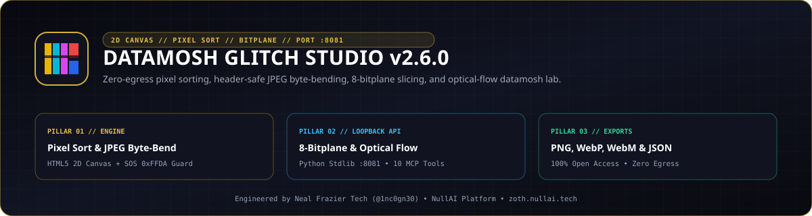

# Datamosh Glitch Studio (`v2.6.0`)

<p align="center">
  
</p>

Zero-egress datamosh synthesizer, luminance pixel sorter, header-safe JPEG byte-bender, true 8-bitplane slicer, Sierpinski spatial XOR engine, and macroblock optical-flow lab with a dual-theme HTML5 2D Canvas workstation (`:8081`), ZothOS CLI/Braille TUI, and 10-tool stdio Model Context Protocol (MCP) server. Zero external Python runtime dependencies.

- **Version**: `2.6.0`
- **Default Loopback Endpoint**: `http://127.0.0.1:8081`
- **Zoth Studio v2 Route**: [https://zoth.nullai.tech/tools/datamosh-glitch-studio](https://zoth.nullai.tech/tools/datamosh-glitch-studio)
- **Author**: Neal Frazier Tech ([`@1nc0gn30`](https://github.com/1nc0gn30)) • [NullAI Platform](https://nullai.tech)
- **License**: MIT (100% free and open-access, zero paywalls)

## What It Does

Datamosh Glitch Studio combines a zero-dependency pure-Python backend (`src/datamosh_glitch_studio/`) with a matching client-side HTML5 2D Canvas engine (`public/datamosh-engine.js` + `public/index.html`):

- **Luminance Pixel Sorting**: Row/column threshold-gated pixel sorting by Rec.601 luminance.
- **Header-Safe JPEG Byte-Bending**: Locates the Start-of-Scan (`0xFF 0xDA`) marker and EOI (`0xFF 0xD9`) guard to mutate entropy scan bytes without corrupting container headers.
- **True 8-Bitplane Slicing & Mosaic (`bitplane_glitch.py`)**: Per-channel (`all`, `r`, `g`, `b`, `luminance`) bitmasking and bit inversion across Bits `0..7` plus XSS-escaped 8-panel SVG activity mosaics.
- **Sierpinski Spatial XOR Fractals**: Coordinate boolean interference (`xor`, `and`, `or`, `xor_and`) blended onto pixel buffers.
- **Macroblock Motion Vectors & Liquid Melt (`motion_vector_engine.py`)**: Block-matching SAD optical-flow estimation, live canvas vector overlay, ASCII/SVG vector maps, and multi-step liquid-melt P-frame compounding.
- **Real Local Exports**: PNG, WebP, 30fps WebM video loop (`MediaRecorder`), and schema-validated JSON Preset export/import, plus interactive Before/After Split Scrubber and Editorial Ivory Light + Obsidian Gold Dark dual theme.

## How It Works

- **Hardened Loopback Server (`ui_server.py`)**: Strict loopback `Host` allowlist (`403` JSON on DNS-rebinding), exact-port CORS (`:8081` and `:3000` only, blocking port-suffix spoofs like `:80810`), all 4 security headers (`X-Frame-Options`, `X-Content-Type-Options`, `Referrer-Policy`, loopback `CSP`), `HEAD` support, `realpath`/`commonpath` traversal protection (`403` JSON), `1 MiB` `POST` cap (`413` JSON), and bounded dimensions (`16..2048` px, `MAX_PIXELS = 2048 * 2048`) blocking BMP/PPM header OOM bombs.
- **Zero External Egress**: Zero Google Fonts, zero analytics, zero cloud APIs. Runs identically on `127.0.0.1:8081` and statically on Netlify with local fallbacks.

## Quickstart

```bash
git clone https://github.com/1nc0gn30/datamosh-glitch-studio.git
cd datamosh-glitch-studio
python3 server.py --port 8081
# Verify health:
curl -s http://127.0.0.1:8081/health
```

## ZothOS CLI, Braille TUI & MCP Commands

```bash
# Status, version, and portable JSON telemetry (zero /home/<user> leaks)
datamosh-glitch-studio --version
datamosh-glitch-studio --status --json
datamosh-glitch-studio diagnostics --json

# Render a glitched BMP frame from SMPTE test card or BMP/PPM input
datamosh mosh -p cyberpunk_vcr --width 480 --height 320 --seed 42 -o /tmp/glitched.bmp

# Isolate/invert 8-bitplanes and export 8-panel SVG mosaic
datamosh bitplane --keep-bits 7,6,5 --invert-bits 7 --mosaic /tmp/mosaic.svg -o /tmp/bitplane.bmp

# Estimate macroblock optical flow and render ASCII/SVG vectors
datamosh motion --width 160 --height 120 --block-size 16 --svg /tmp/flow.svg --json

# Synthesize liquid-melt sequence HTML player & Sierpinski XOR frames
datamosh melt --steps 8 --acc 1.2 -o /tmp/melt.html
datamosh xor --formula xor --scale 1.0 --blend 0.5 -o /tmp/xor.bmp

# Launch real Unicode U+2800 Braille optical-flow & bitplane telemetry TUI
datamosh-glitch-studio-tui --once
datamosh-glitch-studio-tui --json

# Launch JSON-RPC 2.0 MCP stdio server (10 real datamosh_* tools)
datamosh mcp
```

### Registered MCP Tools (10)

1. `datamosh_apply` — Apply parametric glitch presets to Base64 BMP/PPM or procedural color bars.
2. `datamosh_generate_sequence` — Generate multi-frame continuous I-frame drop sequences.
3. `datamosh_presets` — List all glitch presets and parameter definitions.
4. `datamosh_corrupt_bytes` — Corrupt Base64 binary payloads while protecting header bytes.
5. `datamosh_motion_estimate` — Estimate macroblock motion vectors and render ASCII/SVG maps.
6. `datamosh_liquid_melt` — Compound macroblock displacement across frames.
7. `datamosh_bitplane_slice` — Isolate or invert 8-bit channel bitplanes (`0..7`).
8. `datamosh_sierpinski_xor` — Synthesize spatial coordinate boolean glitch textures.
9. `datamosh_bitplane_mosaic` — Render an XSS-escaped 8-panel bitplane activity SVG mosaic.
10. `datamosh_diagnostics` — Inspect runtime and engine health.

### REST API Endpoints (`127.0.0.1:8081`)

| Method | Path | Description |
| :--- | :--- | :--- |
| `GET` / `HEAD` | `/health`, `/api/health` | Service status, `v2.6.0`, uptime, and UTC timestamp |
| `GET` | `/api/presets` | List registered glitch presets |
| `GET` | `/api/diagnostics` | Runtime, platform, and preset count diagnostics |
| `GET` | `/api/bitplane-mosaic` | Render an 8-bitplane SVG mosaic (`channel` validated against strict allowlist) |
| `POST` | `/api/mosh` | Apply preset glitching to Base64 BMP/PPM or color bars |
| `POST` | `/api/sequence` | Synthesize a multi-frame Base64 BMP sequence (`1..60` frames) |
| `POST` | `/api/corrupt` | Header-safe Base64 byte-stream corruption |
| `POST` | `/api/motion-estimate` | Macroblock optical flow (`4 <= block_size <= 128`), ASCII grid, and SVG map |
| `POST` | `/api/liquid-melt` | Multi-step liquid-melt compounded frame array |
| `POST` | `/api/bitplane-slice` | True 8-bitplane slicing and bit inversion |
| `POST` | `/api/sierpinski-xor` | Spatial coordinate boolean (`xor`, `and`, `or`, `xor_and`) textures |

## Testing & Verification

```bash
PYTHONPATH=src pytest -q
PYTHONPATH=src python3 -m datamosh_glitch_studio.cli test
node --test tests/test_frontend_engine.mjs
```

## Support

Datamosh Glitch Studio is 100% free and open-access software with zero paywalls.
- [Buy Us a Coffee (Stripe)](https://buy.stripe.com/3cIfZg27PdKo2D64Ocfw40X)
- Solana Tip: `GG2eQbVh8ut1BK6j1A2tz7pSySdLpD38BgyEhGcxdXoK`

## License

MIT License. Engineered by Neal Frazier Tech ([@1nc0gn30](https://github.com/1nc0gn30)) • [NullAI Platform](https://nullai.tech).
