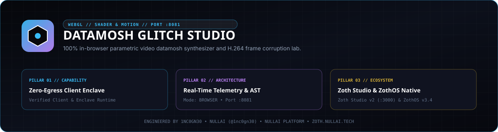

# Datamosh Glitch Studio

<p align="center">
  
</p>

Parametric datamosh synthesizer, H.264 I-frame drop simulator, macroblock optical-flow motion estimator, 8-bitplane slicer, and spatial boolean texture engine with a local web workstation, CLI, and stdio Model Context Protocol (MCP) server. Zero external Python runtime dependencies.

- **Version**: `2.5.0`
- **Default Loopback Endpoint**: `http://127.0.0.1:8081`
- **Zoth Studio v2 Dossier**: [https://zoth.nullai.tech/tools/datamosh-glitch-studio](https://zoth.nullai.tech/tools/datamosh-glitch-studio)
- **Author**: 1nc0gn30 (`@1nc0gn30` · [https://1nc0gn30.si](https://1nc0gn30.si)) & NullAI ([https://nullai.tech](https://nullai.tech))
- **License**: MIT (100% free and open-source)

## Overview

Datamosh Glitch Studio implements deterministic pixel-buffer and bitstream manipulation in pure Python (`src/datamosh_glitch_studio/`) alongside an in-browser HTML5 Canvas workstation (`public/index.html`):

- **Parametric Frame & Sequence Glitching (`glitch_core.py`, `presets.py`)**: Horizontal slice shifting, macroblock displacement, RGB channel chromatic split, CRT scanlines, temporal ghosting, and audio-modulated preset curves across 24-bit uncompressed BMP and P6 PPM frames.
- **Macroblock Motion Vector Estimation (`motion_vector_engine.py`)**: Block-matching optical flow estimation, ASCII/SVG motion vector maps, and multi-step liquid-melt P-frame compounding (`datamosh_liquid_melt`).
- **Bitplane Slicing & Boolean Fractals (`bitplane_glitch.py`)**: Per-channel (`all`, `r`, `g`, `b`, `luminance`) bitplane isolation/inversion (LSB `0` to MSB `7`), 8-panel SVG bitplane activity mosaics, and spatial coordinate `XOR`/`AND`/`OR` Sierpinski textures.
- **Header-Safe Byte Corruption (`corrupt_byte_stream`)**: Controlled bitflips, byte zeroing, and jitter injection while preserving configurable file header offsets.

## Architecture

```text
datamosh-glitch-studio/
├── assets/hero-banner.svg                  # Studio vector banner
├── server.py                               # Sovereign server launcher (127.0.0.1:8081)
├── bin/datamosh.js                         # Unified CLI, web, and Electron launcher
├── public/index.html                       # Standalone client-side Canvas workstation & WebM recorder
├── src/datamosh_glitch_studio/
│   ├── glitch_core.py                      # DatamoshEngine & header-safe byte stream corrupter
│   ├── motion_vector_engine.py             # Macroblock optical flow & liquid-melt sequence generator
│   ├── bitplane_glitch.py                  # Bitplane extractor, slicer, mosaic SVG, & XOR textures
│   ├── frame_io.py                         # Zero-dependency 24-bit BMP, P6 PPM, & HTML loop codecs
│   ├── presets.py                          # Parametric glitch preset catalog
│   ├── ui_server.py                        # ThreadingHTTPServer REST API & static host (:8081)
│   ├── mcp_server.py                       # JSON-RPC 2.0 stdio MCP server (2024-11-05, 10 tools)
│   └── cli.py                              # Subcommand CLI (datamosh / datamosh-studio)
└── tests/                                  # Pytest unit, CLI, MCP, origin-guard, & HTTP API suite
```

## Quickstart

Clone the repository and install in editable mode:

```bash
git clone https://github.com/1nc0gn30/datamosh-glitch-studio.git
cd datamosh-glitch-studio
python3 -m pip install -e ".[dev]"
```

Start the local workstation and REST server on `127.0.0.1:8081`:

```bash
datamosh serve --host 127.0.0.1 --port 8081
# or via the Node wrapper:
node bin/datamosh.js web
```

Verify service health:

```bash
curl -s http://127.0.0.1:8081/health
```

## CLI & MCP Usage

### CLI Subcommands

 Both `datamosh` (`datamosh-studio`) and `node bin/datamosh.js` expose the full CLI surface:

```bash
# Help, version, and JSON status
datamosh --help
datamosh --version
datamosh --status --json

# Render a glitched BMP frame from an input BMP/PPM or procedural SMPTE test card
datamosh mosh --preset h264_iframe_drop --width 480 --height 320 --seed 42 -o glitched.bmp

# List all parametric glitch presets
datamosh presets --json

# Estimate macroblock motion vectors and export an SVG vector field
datamosh motion --width 160 --height 120 --block-size 16 --shift-dx 4 --shift-dy 2 --svg flow.svg --json

# Render a multi-frame liquid-melt HTML loop player
datamosh melt --steps 8 --acc 1.2 -o melt.html

# Isolate/invert bitplanes and render an 8-bitplane SVG mosaic
datamosh bitplane --keep-bits 7,6,5 --invert-bits 0 --channel all --mosaic mosaic.svg -o sliced.bmp

# Synthesize spatial boolean fractal textures
datamosh xor --formula xor --scale 1.0 --blend 0.5 -o xor_glitched.bmp

# Header-safe binary byte-stream corruption
datamosh corrupt glitched.bmp -o corrupted.bmp --rate 0.002 --header-skip 64

# Environment diagnostics and self-check
datamosh doctor
datamosh test
```

### ZothOS v3.4.0 Integration

On ZothOS v3.4.0 workstations, `datamosh` is linked onto the system `PATH` and integrates with the Zoth Studio v2 dossier (`https://zoth.nullai.tech/tools/datamosh-glitch-studio`) over loopback port `127.0.0.1:8081` with strict local-origin CORS enforcement (`localhost`, `127.0.0.1`, `::1`).

### REST API Endpoints (`127.0.0.1:8081`)

| Method | Path | Description |
| :--- | :--- | :--- |
| `GET` | `/health`, `/api/health` | Service status, uptime, and UTC timestamp |
| `GET` | `/api/presets` | List registered glitch presets and parameter curves |
| `GET` | `/api/diagnostics` | Python runtime, platform, and preset count diagnostics |
| `GET` | `/api/bitplane-mosaic` | Render an 8-bitplane SVG mosaic (`?channel=luminance&width=320&height=240`) |
| `POST` | `/api/mosh` | Apply preset glitching to Base64 BMP/PPM or generated color bars |
| `POST` | `/api/sequence` | Synthesize a multi-frame Base64 BMP datamosh sequence |
| `POST` | `/api/corrupt` | Corrupt Base64 payload bytes while skipping protected header bytes |
| `POST` | `/api/motion-estimate` | Compute macroblock optical flow, ASCII grid, and SVG vector map |
| `POST` | `/api/liquid-melt` | Compound motion vectors into a multi-step liquid-melt frame array |
| `POST` | `/api/bitplane-slice` | Slice and invert 8-bit color channel bitplanes |
| `POST` | `/api/sierpinski-xor` | Apply spatial coordinate boolean (`xor`, `and`, `or`, `xor_and`) textures |

### MCP Server (`stdio`)

Launch the JSON-RPC 2.0 MCP server (`protocolVersion: 2024-11-05`):

```bash
datamosh mcp
```

Registered MCP tools (10):

1. `datamosh_apply` — Apply parametric datamosh/glitch presets to Base64 BMP/PPM or procedural test cards.
2. `datamosh_generate_sequence` — Generate 2–30 frame continuous I-frame drop sequences.
3. `datamosh_presets` — List all glitch presets and parameter definitions.
4. `datamosh_corrupt_bytes` — Corrupt Base64 binary streams with header protection.
5. `datamosh_motion_estimate` — Estimate macroblock motion vectors and render ASCII/SVG flow maps.
6. `datamosh_liquid_melt` — Compound macroblock displacement across frames for liquid-melt synthesis.
7. `datamosh_bitplane_slice` — Isolate or invert 8-bit channel bitplanes (`0..7`).
8. `datamosh_sierpinski_xor` — Synthesize spatial coordinate boolean glitch textures.
9. `datamosh_bitplane_mosaic` — Render an 8-panel SVG mosaic of bitplanes `0` through `7`.
10. `datamosh_diagnostics` — Inspect runtime and engine health.

## Testing & Verification

Run the test suite and secret scan locally:

```bash
python3 -m pytest -q
node bin/datamosh.js --status --json
gitleaks detect --source . --no-banner --redact
```

## Support

Datamosh Glitch Studio is 100% free and open-source with zero paywalls. Optional community support: [Buy Us a Coffee via Stripe](https://buy.stripe.com/3cIfZg27PdKo2D64Ocfw40X).

## License

Released under the [MIT License](LICENSE). Copyright (c) 2026 1nc0gn30 & NullAI ([https://nullai.tech](https://nullai.tech)).
